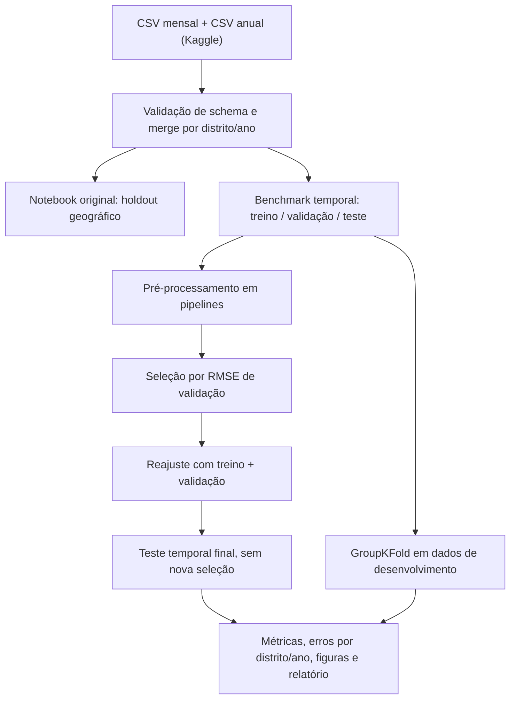
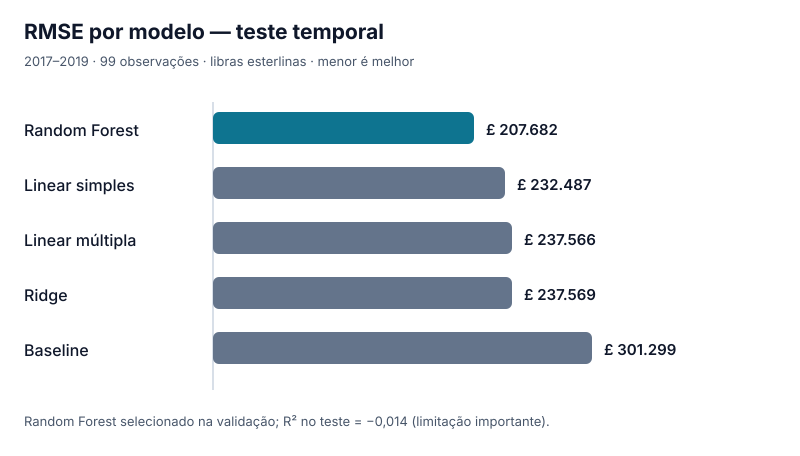

# Housing in London | Benchmark de Machine Learning

[](https://github.com/FelipeStv0/regressao-imoveis-londres/actions/workflows/reproducibility.yml)

Projeto de **portfólio em Ciência de Dados e Machine Learning**: regressão sobre preços médios históricos de distritos de Londres, com pipelines, testes, separações de treino/validação/teste, diagnósticos, análise de erros e execução reproduzível.

> **Escopo e responsabilidade:** os dados representam **médias por distrito e ano, não preços de imóveis individuais**. Este é um experimento educacional; **não é um precificador imobiliário confiável** nem fornece previsões utilizáveis em decisões financeiras. Indicadores socioeconômicos anuais são contemporâneos ao alvo, e o estudo temporal não é uma previsão prospectiva ex ante.

## Visão rápida

| Aspecto | Implementação |
| --- | --- |
| Dados | Housing in London, via API oficial do Kaggle ou CSVs locais autorizados |
| Alvo | `average_price` (£), média mensal observada em dezembro |
| Features | `median_salary`, `number_of_jobs`, `recycling_pct` |
| Abordagens | Regressão linear simples/múltipla/polinomial, Ridge, Random Forest e baseline |
| Controle de vazamento | Pré-processamento dentro de `Pipeline`; separações cronológica e por distrito |
| Métricas | MAE, RMSE, R²; análise por distrito/ano; bootstrap por agrupamento |
| Reprodutibilidade | Python 3.11, testes offline, CI no GitHub Actions, hashes SHA-256 e versões instaladas |

## Projeto em duas etapas

**1. Notebook acadêmico original:** [Regressao_Londres_Codigo.ipynb](Regressao_Londres_Codigo.ipynb). Mantém regressão simples, múltipla, polinomial e divisão por distritos inteiros para avaliar extrapolação geográfica; o relatório [PDF](Relatorio_Regressao_Londres.pdf) é preservado como registro histórico.

**2. Benchmark adicional para portfólio:** [scripts/run_benchmark.py](scripts/run_benchmark.py). Introduz divisão temporal (treino até 2013, validação de 2014 a 2016 e teste de 2017 a 2019), seleção de hiperparâmetros na validação, avaliação de cinco famílias de modelos no teste, `GroupKFold` por distrito (somente período de desenvolvimento), importância por permutação na validação e intervalos descritivos por bootstrap de distritos.

Veja [metodologia detalhada e ameaças à validade](docs/metodologia.md), [análise dos resultados](docs/resultados.md) e o [Model Card](docs/model_card.md).



## Resultados verificados — experimento acadêmico original

Reproduzidos em [CI de 08/11/2026](https://github.com/FelipeStv0/regressao-imoveis-londres/actions/runs/42500452023). **Este é o teste com distritos reservados, não o novo teste temporal**.

| Modelo | MAE (£) ↓ | RMSE (£) ↓ | R² ↑ |
| --- | ---: | ---: | ---: |
| Baseline | 169.966 | 270.542 | -0,064 |
| Linear simples | 137.579 | 254.067 | 0,062 |
| Linear múltipla | 139.172 | 256.869 | 0,041 |
| Polinomial grau 2 | 137.459 | **249.094** | **0,098** |

R² baixo e erros elevados indicam limitações preditivas importantes. O polinômio com menor RMSE nesse teste **não é uma solução de precificação**.

## Novo benchmark temporal — resultados reais

**Fonte:** [execução GitHub Actions #42533710022](https://github.com/FelipeStv0/regressao-imoveis-londres/actions/runs/42533710022) em 08/11/2026, com **693 observações no total, 99 no teste temporal e 18 testes automatizados aprovados**. A escolha dos modelos e hiperparâmetros usou apenas 2014–2016; o teste contém 2017–2019.

| Modelo | MAE no teste (£) ↓ | RMSE no teste (£) ↓ | R² no teste ↑ |
| --- | ---: | ---: | ---: |
| Random Forest (selecionado na validação) | **122.305** | **207.682** | **−0,014** |
| Linear simples | 150.304 | 232.487 | −0,270 |
| Linear múltipla | 156.102 | 237.566 | −0,326 |
| Ridge (α = 0,1) | 156.102 | 237.569 | −0,326 |
| Baseline (média) | 220.321 | 301.299 | −1,133 |



**Interpretação:** Random Forest reduziu o RMSE em aproximadamente **31,1% em comparação com o baseline** neste protocolo. No entanto, **R² = −0,014** significa que, em relação à média do próprio conjunto de teste, o poder explicativo continua inadequado. Não é correto descrevê-lo como modelo confiável para estimar preços de imóveis.

O experimento ainda fornece `validacao_temporal.csv`, `teste_temporal.csv`, `geografico_cv_detalhado.csv`, `configuracao.json`, figuras PNG, erros por distrito/ano e relatório Markdown. O campeão é escolhido **antes do teste**, exclusivamente pelo RMSE na validação. Consulte [interpretação completa e comparação geográfica](docs/resultados.md) e as [limitações da metodologia](docs/metodologia.md).

## Reproduzir (Python 3.11)

```bash
git clone https://github.com/FelipeStv0/regressao-imoveis-londres.git
cd regressao-imoveis-londres
python -m venv .venv
```

Ative o ambiente: Windows PowerShell `.venv\Scripts\Activate.ps1` ou Linux/macOS `source .venv/bin/activate`.

```bash
python -m pip install -r requirements-dev.txt
python -m pytest -q tests
# Solicita explicitamente a obtenção dos dois CSVs pela API oficial:
python scripts/prepare_data.py --download
# Notebook original, com gráficos:
mkdir -p artifacts
jupyter nbconvert --to notebook --execute --ExecutePreprocessor.timeout=600 --output executed.ipynb --output-dir artifacts Regressao_Londres_Codigo.ipynb
python scripts/check_results.py artifacts/metricas_teste.csv
# Benchmark novo, com figuras e relatório:
python scripts/run_benchmark.py --dir data --output artifacts/benchmark
python scripts/check_benchmark.py artifacts/benchmark
```

**Acesso e direitos dos dados:** se a API do Kaggle exigir autenticação ou concordância com termos, conclua-os na plataforma ou baixe manualmente os CSVs para `data/`, conforme autorizado. O projeto não redistribui os CSVs e não versiona credenciais. Em caso de download indisponível, o teste de integração deve falhar explicitamente.

Em Windows PowerShell, a linha `mkdir -p artifacts` pode ser substituída por `New-Item -ItemType Directory -Force artifacts`.

## Testes, evidências e artefatos

O workflow [Reprodutibilidade e benchmark de ML](.github/workflows/reproducibility.yml) instala as dependências em ambiente limpo, executa testes sintéticos de integridade e controle de vazamento, baixa dados reais, executa o notebook original e o benchmark e verifica automaticamente os contratos dos resultados. A cada execução, os gráficos, CSVs, relatórios e versões ficam disponíveis na aba [Actions](https://github.com/FelipeStv0/regressao-imoveis-londres/actions) como artefato com retenção de 30 dias. **Sucesso técnico de CI não implica qualidade estatística para produção.**

## Estrutura do repositório

```text
.
├── .github/workflows/reproducibility.yml
├── Regressao_Londres_Codigo.ipynb    # Estudo original preservado
├── Relatorio_Regressao_Londres.pdf  # Relatório acadêmico histórico
├── docs/
│   ├── metodologia.md               # Protocolo e ameaças à validade
│   ├── resultados.md                # Resultados reproduzidos e interpretação
│   ├── model_card.md                # Limitações, riscos e uso permitido
│   └── figures/rmse_teste_temporal.svg
├── scripts/
│   ├── prepare_data.py              # CSV local ou download opt-in
│   ├── london_benchmark.py          # Dataset, modelos e métricas
│   ├── run_benchmark.py             # Experimento reproduzível e figuras
│   ├── check_benchmark.py           # Contratos de artefatos
│   └── check_results.py             # Contratos do notebook original
├── tests/
│   ├── test_pipeline.py
│   └── test_benchmark.py
├── requirements.txt
└── requirements-dev.txt
```

## Limites de interpretação

A base contém aproximadamente 33 distritos e observações históricas por ano, não transações imobiliárias individuais. Falta informação de metragem, tipo, estado, localização precisa e disponibilidade real das variáveis no momento de previsão. Erros extremos e diferenças entre distritos exigem cautela; intervalos descritivos por bootstrap não são garantias de cobertura futura. Os resultados demonstram **processo de modelagem, avaliação crítica e engenharia reproduzível** — não estimativa imobiliária de uso comercial.
