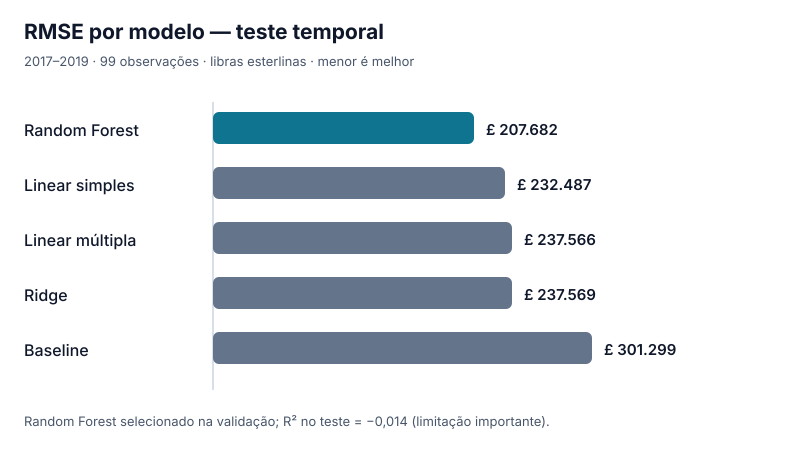

# Housing in London — Machine Learning Benchmark

**Language:** [English](README_EN.md) | [Português](README.md)

A **data science and machine learning portfolio project** that studies historical average house prices in London boroughs. It compares regression models, checks prediction errors, and uses automated tests to make the results easier to reproduce.

> **Important limitation:** the dataset contains **average prices by borough and year**, not prices of individual homes. This is an educational analysis, **not a reliable real estate pricing tool**. Some input data comes from the same year as the price being studied, so this is a retrospective analysis, not a real-world forecast made in advance.

## Project overview

| Topic | Implementation |
| --- | --- |
| Data | Housing in London, from authorized Kaggle CSV files |
| Target | `average_price` in pounds (£), using the December observation |
| Input features | `median_salary`, `number_of_jobs`, `recycling_pct` |
| Models | Baseline, simple/multiple linear regression, polynomial regression, Ridge, Random Forest |
| Evaluation | MAE, RMSE, R², error analysis, temporal and geographic splits |
| Data preparation | scikit-learn `Pipeline`, missing-value handling, scaling when needed |
| Reproducibility | Python 3.11, pytest, GitHub Actions, saved versions and SHA-256 hashes |

## Two parts of the project

### 1. Original academic notebook

[`Regressao_Londres_Codigo.ipynb`](Regressao_Londres_Codigo.ipynb) contains the original academic study. It compares linear and polynomial models and holds out complete boroughs to study performance on different areas. The [original report (PDF)](Relatorio_Regressao_Londres.pdf) is kept as a historical record.

### 2. Reproducible benchmark

[`scripts/run_benchmark.py`](scripts/run_benchmark.py) adds a second evaluation with **separate time periods**:

| Data group | Period | Purpose |
| --- | --- | --- |
| Training | Up to 2013 | Train candidate models |
| Validation | 2014–2016 | Choose models and settings |
| Test | 2017–2019 | Final evaluation |

The test set is not used to choose the model. After validation, selected models are trained again using training and validation data, then checked on the test period.

The project also includes `GroupKFold` by borough on development data, permutation feature importance calculated on validation data, grouped bootstrap analysis, and errors by borough and year.

~~~mermaid
flowchart TD
    A[Monthly and yearly CSV files] --> B[Check columns and merge records]
    B --> C[Original notebook: borough holdout]
    B --> D[Time-based training / validation / test]
    D --> E[Preprocessing inside pipelines]
    E --> F[Select model using validation RMSE]
    F --> G[Retrain on training + validation]
    G --> H[Final test and error reports]
    D --> I[Geographic analysis with GroupKFold]
    I --> H
~~~

## Results

### Original academic evaluation — held-out boroughs

The original notebook reported the following reproduced results:

| Model | MAE (£) ↓ | RMSE (£) ↓ | R² ↑ |
| --- | ---: | ---: | ---: |
| Mean baseline | 169,966 | 270,542 | -0.064 |
| Simple linear | 137,579 | 254,067 | 0.062 |
| Multiple linear | 139,172 | 256,869 | 0.041 |
| Polynomial degree 2 | 137,459 | **249,094** | **0.098** |

These results come from the **geographic holdout**, not the time-based benchmark. R² values remain low, so the predictions have major limitations.

### Time-based benchmark — final test

The benchmark contains **693 observations in total** and **99 test observations**. Models were selected using validation years only.

| Model | Test MAE (£) ↓ | Test RMSE (£) ↓ | Test R² ↑ |
| --- | ---: | ---: | ---: |
| Random Forest (selected in validation) | **122,305** | **207,682** | **-0.014** |
| Simple linear | 150,304 | 232,487 | -0.270 |
| Multiple linear | 156,102 | 237,566 | -0.326 |
| Ridge (alpha = 0.1) | 156,102 | 237,569 | -0.326 |
| Mean baseline | 220,321 | 301,299 | -1.133 |

In this experiment, Random Forest reduced RMSE by about **31.1% compared with the baseline**. However, its **negative test R² (-0.014)** means it still performs slightly worse than simply predicting the test set mean under that metric. It is **not suitable for commercial home pricing**.

These are two different test methods, and their numbers must not be compared as if they were the same experiment.

More details: [methodology](docs/metodologia.md), [results](docs/resultados.md), and [model card](docs/model_card.md). The detailed supporting documents are currently in Portuguese.

## How to run — Python 3.11

~~~bash
git clone https://github.com/FelipeStv0/regressao-imoveis-londres.git
cd regressao-imoveis-londres
python -m venv .venv
~~~

Activate the environment:
- **Windows PowerShell:** `.venv\Scripts\Activate.ps1`
- **Linux/macOS:** `source .venv/bin/activate`

Install dependencies and run tests:

~~~bash
python -m pip install -r requirements-dev.txt
python -m pytest -q tests
~~~

Download the two dataset files **only when authorized**:

~~~bash
python scripts/prepare_data.py --download
~~~

If Kaggle requires an account or agreement, complete it through the official service or place authorized local files under `data/`. No Kaggle credentials or dataset files are committed to this repository.

Run the original notebook and validate its saved results:

~~~bash
mkdir -p artifacts
jupyter nbconvert --to notebook --execute --ExecutePreprocessor.timeout=600 --output executed.ipynb --output-dir artifacts Regressao_Londres_Codigo.ipynb
python scripts/check_results.py artifacts/metricas_teste.csv
~~~

On Windows PowerShell, use `New-Item -ItemType Directory -Force artifacts` instead of `mkdir -p artifacts`.

Run the second benchmark and check its reports:

~~~bash
python scripts/run_benchmark.py --dir data --output artifacts/benchmark
python scripts/check_benchmark.py artifacts/benchmark
~~~

## Outputs and automated checks

The benchmark creates:
- `validacao_temporal.csv` and `teste_temporal.csv` for model comparison;
- `geografico_cv_detalhado.csv` for borough-based checks;
- `predicoes_teste.csv` and error reports by borough and year;
- `configuracao.json` with settings, versions, and input file hashes;
- figures and a Markdown benchmark report.

The [GitHub Actions workflow](.github/workflows/reproducibility.yml) installs dependencies in a clean environment, runs offline tests, downloads the authorized dataset, executes the original notebook and benchmark, and checks output files. Generated reports are available as temporary workflow artifacts.

**Passing the automated checks means the experiment ran correctly. It does not mean the model is accurate enough for production.**

## Code structure

| Path | Responsibility |
| --- | --- |
| `scripts/prepare_data.py` | Use local CSVs or explicitly download data |
| `scripts/data_protocol.py` | Validate data, merge tables, create time splits |
| `scripts/model_registry.py` | Define models and preprocessing pipelines |
| `scripts/london_benchmark.py` | Metrics, selection, geographic checks, error analysis |
| `scripts/run_benchmark.py` | Run experiments and save results and figures |
| `scripts/check_benchmark.py` | Validate generated benchmark files |
| `tests/` | Data quality, protocol, and metric tests |
| `docs/` | Methodology, model card, results, maintenance guide |

The previous imports from `scripts.london_benchmark` remain available for compatibility. For changes and future integrations, see the [maintenance guide](docs/GUIA_MANUTENCAO.md).

## Limitations

The dataset includes borough-level averages, not individual transactions. It does not include important details such as property size, condition, exact location, or all economic conditions. Input features may only be known after the year being studied. Geographic differences and large errors limit the value of the results.

The purpose of this project is to demonstrate **data processing, careful evaluation, reproducible experiments, and clear reporting of limitations**.
