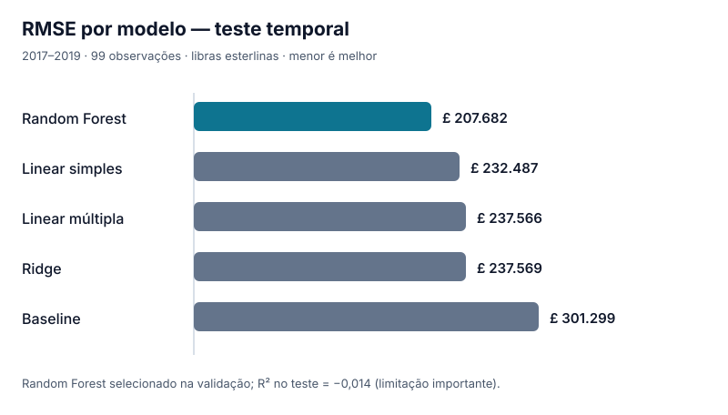

# Resultados reproduzidos do benchmark temporal

<small>Execução registrada em 8 de novembro de 2026. Dados: Housing in London via API do Kaggle. Evidência: [GitHub Actions #42533710022](https://github.com/FelipeStv0/regressao-imoveis-londres/actions/runs/42533710022).</small>

## Resumo executivo

O **Random Forest foi escolhido exclusivamente por RMSE de validação**, antes de utilizar as observações de teste (2017–2019). Comparado ao baseline, reduziu o RMSE do teste em aproximadamente **31,1%**. Entretanto, seu **R² de −0,014** demonstra que o modelo ainda não alcança desempenho explicativo satisfatório na amostra temporal reservada. O objetivo deste projeto é demonstrar método, não produzir avaliações imobiliárias comerciais.

## Amostra e protocolos

- Total: **693 observações**, referentes a **33 distritos** e anos históricos.
- Desenvolvimento: treino até 2013; validação de 2014 a 2016; teste de 2017 a 2019 (**99 observações**).
- Reajuste final: treino+validação após seleção; nenhuma configuração foi alterada por resultados do teste.
- A avaliação geográfica usa `GroupKFold(5)` apenas no período até 2016; é diagnóstica, pois compartilha período de seleção de hiperparâmetros.
- Preditores do mesmo ano usados retrospectivamente, não dados garantidamente disponíveis em uma data real de previsão.

## Seleção na validação temporal

| Modelo | Configuração | MAE validação (£) ↓ | RMSE validação (£) ↓ | R² validação ↑ |
| --- | --- | ---: | ---: | ---: |
| Random Forest | 200 árvores; min_samples_leaf = 2 | **149.738** | **225.919** | −0,064 |
| Linear múltipla | Sem regularização | 164.026 | 250.596 | −0,309 |
| Ridge | α = 0,1 | 164.033 | 250.602 | −0,309 |
| Linear simples | Salário mediano | 181.157 | 265.722 | −0,472 |
| Baseline | Média do treino | 228.675 | 315.409 | −1,074 |

O parâmetro de Ridge foi buscado em 0,1; 1; 10; 100; 1000. O parâmetro `min_samples_leaf` do Random Forest foi buscado em 2; 5; 10. A escolha global ocorreu pela mesma métrica de validação.

## Teste temporal final

| Modelo | MAE teste (£) ↓ | RMSE teste (£) ↓ | R² teste ↑ |
| --- | ---: | ---: | ---: |
| Random Forest (campeão de validação) | **122.305** | **207.682** | **−0,014** |
| Linear simples | 150.304 | 232.487 | −0,270 |
| Linear múltipla | 156.102 | 237.566 | −0,326 |
| Ridge | 156.102 | 237.569 | −0,326 |
| Baseline | 220.321 | 301.299 | −1,133 |

**Leitura correta:** ter erro menor do que a média estimada do período de treinamento não implica alcançar o desempenho de uma média calculada com o conjunto avaliado. É possível melhorar muito em relação ao baseline e ainda obter R² negativo.

## Diagnóstico por área (GroupKFold, desenvolvimento)

| Modelo | Média RMSE (£) | Desvio-padrão entre 5 folds (£) | Média R² |
| --- | ---: | ---: | ---: |
| Ridge | 129.396 | 70.012 | 0,416 |
| Linear múltipla | 129.398 | 70.013 | 0,416 |
| Linear simples | 139.512 | 69.570 | 0,321 |
| Random Forest | 145.899 | 59.283 | 0,208 |
| Baseline | 169.417 | 52.710 | −0,057 |

Esses resultados são **exploratórios**, não avaliação independente pós-seleção. Os desvios grandes indicam heterogeneidade entre distritos. Observe também que o melhor modelo temporal **não** foi o melhor em média no diagnóstico geográfico: as tarefas e suas distribuições diferem.

## Diagnóstico e limitações

Os artefatos incluem gráficos observado vs. previsto, MAE por ano, distritos com maiores MAEs, importância de variáveis por permutação na validação, predições linha a linha do teste e intervalos descritivos percentis com 1.000 reamostragens de distritos inteiros. Os intervalos são descritivos e **não** garantem cobertura de valores futuros.

Imóveis individuais exigiriam características e transações individuais. Variáveis anuais contemporâneas tornam essa análise **retrospectiva**, não um sistema que prediz valores antes de as variáveis serem conhecidas. Não utilizar para precificação, investimento, avaliação de garantias ou concessão de crédito.

## Auditoria e reprodução

As métricas arredondadas acima foram extraídas dos logs da execução [#42533710022](https://github.com/FelipeStv0/regressao-imoveis-londres/actions/runs/42533710022), após aprovação dos **18 testes** e verificação dos artefatos. A versão completa (com casas decimais, hashes dos dois CSVs e versões das dependências) está no artefato `reproducibilidade-completa` da execução. Os arquivos `artifacts/benchmark/relatorio_benchmark.md` e `artifacts/benchmark/configuracao.json` são gerados a cada nova execução e constituem a referência para valores atualizados.
